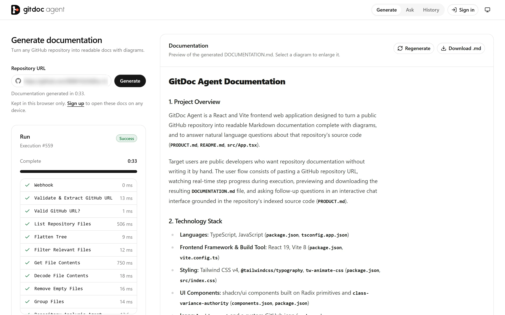
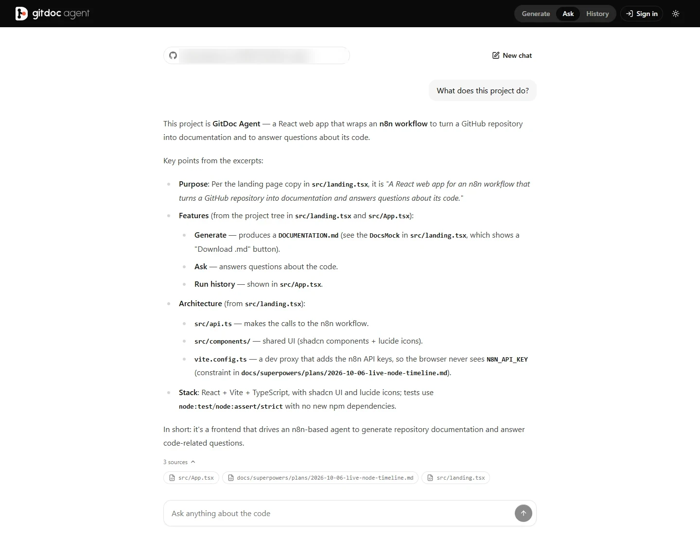
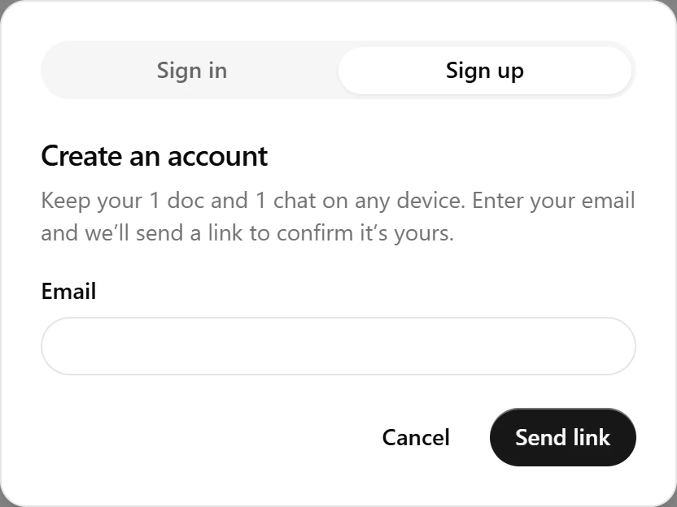

<div align="center">


# GitDoc Agent

**Turn a public GitHub repository into readable documentation with diagrams, then ask questions about its code and get answers with sources.**


</div>

<picture>
  <source media="(prefers-color-scheme: dark)" srcset="public/landing/generate-dark.webp">
  
</picture>

## Overview

GitDoc Agent is a React web app in front of a set of [n8n](https://n8n.io) workflows. An AI agent inside n8n reads a
repository, writes a `DOCUMENTATION.md`, renders its diagrams, and indexes the source code so the **Ask** tab can answer
questions grounded in that code.

Paste a URL, watch the run step by step, read the result, and download it.

> [!NOTE]
> The project runs locally next to an n8n instance. It is not hosted yet. See [Project status](#project-status).

## Features

- **Generate.** Paste a public GitHub URL and get one `DOCUMENTATION.md` with a module overview, data models and how
  they relate, the API, how the front end talks to the back end, and ER and sequence diagrams.
- **Live progress.** Every run shows its current step (Checking repository URL, Reading repository files, Writing
  documentation, Rendering diagrams, Finishing up) and how long it has taken.
- **Ask.** A private chat per repository. Every answer lists the files it came from, so you can check it. Follow-up
  questions keep the last few turns as context.
- **Docs viewer.** Rendered Markdown with syntax highlighting, framed tables, a contents sidebar, a full-screen mode,
  Mermaid diagrams drawn in the browser, and a raw Markdown source view.
- **Shared docs cache.** A repository whose files have not changed (same Git tree SHA) returns cached docs at once, with no
  new AI run. **Regenerate** forces a fresh run.
- **No sign-up needed.** Visitors start with an anonymous Supabase session. Their docs and chats stay private to them.
  Creating an account with email and password keeps that history on any device.
- **Light and dark themes**, a landing page at `/`, and a layout that works on phones.

<table>
  <tr>
    <td width="50%">
      <picture>
        <source media="(prefers-color-scheme: dark)" srcset="public/landing/ask-dark.webp">
        
      </picture>
    </td>
    <td width="50%">
      <picture>
        <source media="(prefers-color-scheme: dark)" srcset="public/landing/signup-dark.webp">
        
      </picture>
    </td>
  </tr>
  <tr>
    <td align="center"><sub>Ask, with sources per answer</sub></td>
    <td align="center"><sub>Optional account to keep history</sub></td>
  </tr>
</table>

## How it works

<picture>
  <source media="(prefers-color-scheme: dark)" srcset="docs/readme/how-it-works-dark.svg">
  
</picture>

<sub>Source: [`docs/readme/how-it-works.html`](docs/readme/how-it-works.html) (light) and
[`how-it-works-dark.html`](docs/readme/how-it-works-dark.html). The SVGs are exported from these files.</sub>

1. The browser signs in anonymously with Supabase and sends every `/api` call with its access token.
2. The **API guard** (`server/guard.ts`, a Vite plugin) checks the session, applies per-user and per-IP rate limits, and
   adds the n8n webhook token and API key on the server. The browser never sees those secrets.
3. For `/api/generate`, the guard looks up the repository's tree SHA on GitHub. Unchanged code comes from the shared
   `docs_cache` table. Otherwise the guard calls the n8n **Generate** workflow.
4. The Generate workflow fetches the files in parallel, has the agent write the docs (OpenRouter, with Gemini as
   fallback), renders the diagrams through mermaid.ink, and then loads the code into Supabase (`documents` table,
   Gemini embeddings) so Ask can search it.
5. `/api/ask` goes to the **Ask** workflow: one vector search over that repository plus one LLM call (Groq, with Gemini
   as fallback), with a safety filter in front.
6. `/api/progress` builds a step timeline from n8n's execution list. Only the timeline reaches the browser, never the
   execution data, which holds repository files.

### n8n workflows

The workflows live in your n8n instance and are **not exported in this repository**. The app expects these:

| Workflow | Webhook | Role |
| --- | --- | --- |
| GitDoc - Generate Docs (Fast) | `/webhook/doc-agent-fast` | Reads the repo, writes and renders the docs, then calls Load Repo Code |
| GitDoc - Ask Repo (Supabase) | `/webhook/gitdoc-ask-supabase` | Answers a question from the indexed code, with sources |
| GitDoc - Ask Repo (Supabase) - Load Repo Code | `/webhook/gitdoc-index-supabase` | Embeds the repository's files into Supabase |
| GitDoc - Error Log | (error trigger) | Collects failures from the workflows above |

Every webhook checks the `X-Webhook-Token` header. Live step progress needs the Generate workflow's **Save execution
progress** setting turned on.

### From Pinecone to Supabase

The first version of Ask was a Pinecone-backed n8n agent. It took 80 to 140 seconds per question, because each answer
made 5 to 6 Gemini calls at about 20 seconds each, while the Pinecone search itself took about one second. The current
Ask runs one Supabase vector search and one model call. Generate also went from about 190 seconds to about 35 seconds
after file fetches and diagram renders moved to parallel batches. The original Pinecone workflows are kept in n8n for
reference but are not part of the live path.

## Tech stack

| Layer | Tools |
| --- | --- |
| Front end | React 19, TypeScript, Vite 8, Tailwind CSS 4, Radix UI, shadcn/ui, lucide-react |
| Markdown | marked, DOMPurify, highlight.js, Mermaid |
| Server (dev) | Vite plugin middleware (`server/guard.ts`) and the Vite proxy |
| Data and auth | Supabase Auth (anonymous and email users), Postgres with row-level security, pgvector |
| Automation | n8n workflows calling the GitHub REST API, mermaid.ink, and LLM providers (Groq, OpenRouter, Google Gemini) |
| Quality | `node:test`, oxlint, TypeScript project references |

## Getting started

### Prerequisites

- **Node.js 22.18 or newer.** The tests run `.ts` files directly with Node's type stripping.
- **n8n** running on `http://localhost:5678`, with the workflows above imported, active, and given Gemini and Supabase
  credentials.
- A **Supabase** project.

### 1. Set up Supabase

In the Supabase SQL Editor, run these files in order:

1. [`docs/supabase-setup.sql`](docs/supabase-setup.sql): the `documents` vector table and the `match_documents` search
   function (3072 dimensions, for `gemini-embedding-001`).
2. [`docs/supabase-app.sql`](docs/supabase-app.sql): per-user `generations` and `chats`, the shared `docs_cache`, the
   `api_calls` table, and the `rate_limit_hit` function.

Then turn on **anonymous sign-ins** under Authentication. Both scripts are safe to re-run.

### 2. Configure the environment

Create a `.env` file in the project root:

```dotenv
# n8n (server only: no VITE_ prefix, so these never reach the browser)
N8N_URL=http://localhost:5678
N8N_WEBHOOK_TOKEN=...
N8N_API_KEY=...
N8N_WEBHOOK_PATH=/webhook/doc-agent-fast
N8N_ASK_WEBHOOK_PATH=/webhook/gitdoc-ask-supabase
N8N_WORKFLOW_ID=<id of "GitDoc - Generate Docs (Fast)">

# Supabase
VITE_SUPABASE_URL=https://<project-ref>.supabase.co
VITE_SUPABASE_PUBLISHABLE_KEY=sb_publishable_...
SUPABASE_SERVICE_ROLE_KEY=sb_secret_...   # server only, never VITE_

# Optional
# GITHUB_TOKEN=...      # raises GitHub's limit of 60 tree lookups an hour
# SMOKE_REPO=https://github.com/<owner>/<repo>   # an indexed repo for npm run smoke
```

> [!IMPORTANT]
> Never give `SUPABASE_SERVICE_ROLE_KEY`, `N8N_API_KEY` or `N8N_WEBHOOK_TOKEN` a `VITE_` prefix. Vite exposes `VITE_`
> variables to the browser bundle.

### 3. Install and run

```bash
npm install
```

```bash
npm run dev
```

- Landing page: http://localhost:5173/
- App: http://localhost:5173/app/ (the landing form opens it with `?repo=<url>` filled in)

The dev server uses port 5173 only (`strictPort`), because a second port would be a separate origin with its own session.

## Scripts

| Command | What it does |
| --- | --- |
| `npm run dev` | Starts the Vite dev server with the API guard and proxy |
| `npm run build` | Type-checks and builds the landing page and the app into `dist/` |
| `npm run preview` | Serves the build. It has **no** `/api` proxy, so Generate and Ask do not work there |
| `npm test` | Runs the unit tests in `src/` and `server/` |
| `npm run smoke` | Calls the live n8n webhooks to check the workflows (uses a few free-tier LLM calls) |
| `npm run lint` | Runs oxlint |

## API

The browser calls three routes. Each one needs `Authorization: Bearer <Supabase access token>`.

| Route | Method | Body or query | Response |
| --- | --- | --- | --- |
| `/api/generate` | POST | `{ repo, runId, fresh? }` | `{ markdown, preview, cached }` |
| `/api/ask` | POST | `{ repo, question, sessionId, history }` | `{ answer, sources, found }` |
| `/api/progress` | GET | `?runId=<id>` | Step timeline of that run |

`runId` is a random ID the browser creates, so only that browser can read the run's progress.

### Rate limits

Enforced by `server/guard.ts` through the `rate_limit_hit` function in Supabase. A reached limit returns `429` with a
`Retry-After` header.

| Kind | Per user | Per IP |
| --- | --- | --- |
| Generate (new AI runs only) | 5 an hour, 15 a day | 10 an hour |
| Ask | 30 an hour | 60 an hour |
| Repository lookups (every `/api/generate`) | 30 an hour | 60 an hour |
| Progress polling | 40 a minute | |

If Supabase cannot be reached, the guard **fails closed** with `503`, so no paid call goes through unchecked.

## Security and privacy

- **Secrets stay on the server.** The n8n token, n8n API key and Supabase service role key exist only in the dev server.
- **Private data per user.** Row-level security limits `generations` and `chats` to their owner. `documents`,
  `docs_cache` and `api_calls` have no browser access at all.
- **Read-only on repositories.** The workflows only send GET requests to GitHub. Nothing in a repository changes.
- **Secrets in code stay out.** `.env` files are skipped when files are fetched and indexed. Secrets found in code are
  written as `<redacted>` in the docs.
- **Prompt-injection guard.** Ask runs a safety filter and refuses to reveal credentials. Instructions hidden in a
  question or in the code are ignored.
- **Bounded input.** Request bodies over 10 KB are rejected, questions are capped at 1000 characters, and the database
  keeps only each user's newest rows.

## Testing

```bash
npm test
```

The unit tests (48 at the time of writing) cover the API client, the guard and its rate limits, the docs cache flow,
the Vite config, Markdown rendering, and session handling. They need no network.

```bash
npm run smoke
```

The smoke test calls the real n8n webhooks. It checks that calls without the token are rejected, that invalid URLs and
empty questions fail cleanly, that a jailbreak prompt is blocked, that Ask answers with sources, and that every live
workflow is active and reports errors to GitDoc - Error Log.

## Project structure

```text
.
├── index.html               Landing page entry (/)
├── app/index.html           App entry (/app/)
├── src/
│   ├── App.tsx              Generate, Ask and History tabs
│   ├── landing.tsx          Landing page
│   ├── api.ts               Browser API client and step definitions
│   ├── progress.ts          Turns n8n executions into a step timeline
│   ├── components/          Docs viewer, account dialog, theme toggle, shadcn/ui parts
│   └── lib/                 Supabase client, session, history, chats, Markdown, diagrams
├── server/guard.ts          API guard: session check, rate limits, docs cache, n8n calls
├── scripts/smoke.ts         Smoke test for the live n8n workflows
├── docs/                    Supabase SQL and implementation plans
├── public/                  Favicon and landing screenshots
└── vite.config.ts           Two-page build, guard plugin and /api/ask proxy
```

## Project status

GitDoc Agent works end to end on a local machine. These items are still open:

- **No production server.** The API guard and proxy run only inside `npm run dev`. Deployment would move
  `server/guard.ts` to serverless functions (it is written as plain functions for that reason) and host n8n separately.
- **Public repositories only.** Private repositories need GitHub sign-in, which does not exist yet.
- **Long waits.** A Generate run usually takes a few minutes. An Ask answer can take up to two minutes on the free Gemini
  tier.
- **Workflow exports.** The n8n workflows are not yet exported into this repository.

## Contributing

1. Create a branch from `main`.
2. Use [Conventional Commits](https://www.conventionalcommits.org/) messages, for example `feat(ask): ...` or
   `fix(app): ...`.
3. Run `npm test` and `npm run lint` before you open a pull request.

## License

No license has been chosen yet. Until one is added, all rights are reserved by the author.

---

<sub>GitDoc Agent is an independent project. It is not affiliated with or endorsed by GitHub.</sub>
